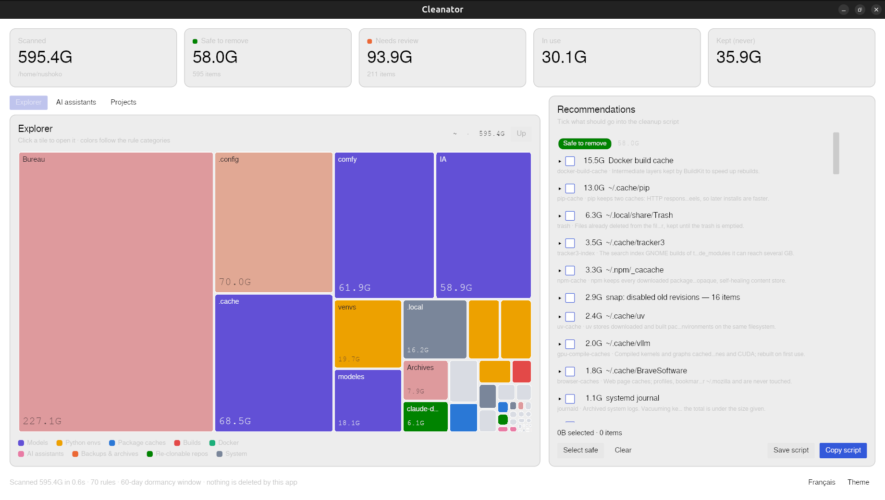
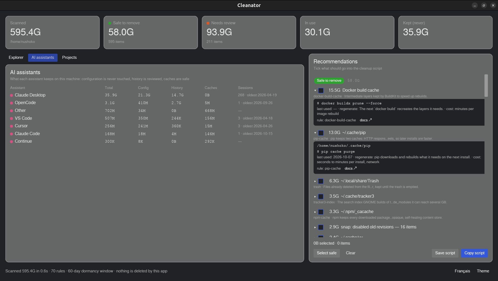
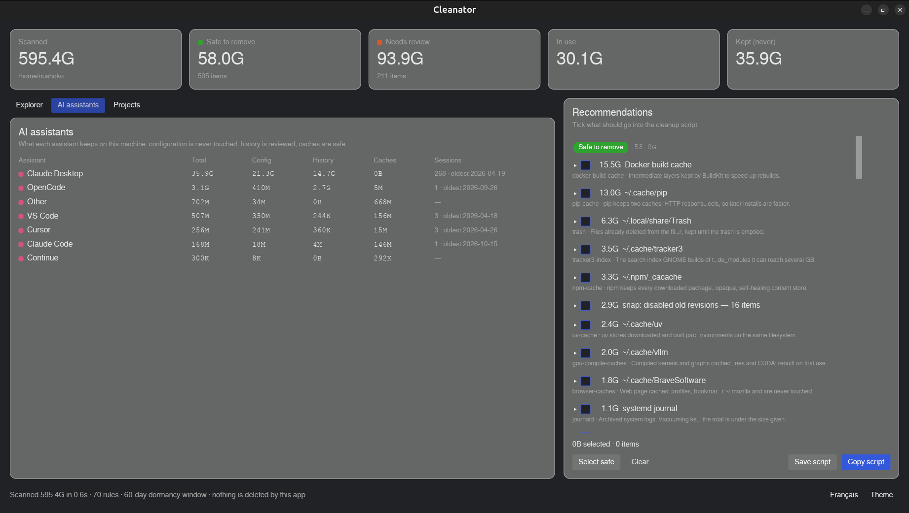
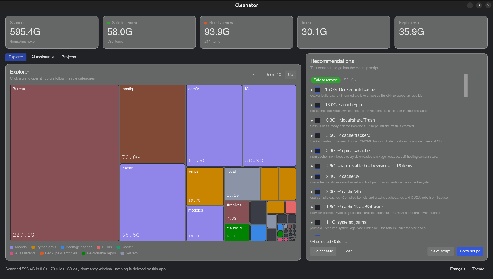

# Cleanator

**Disk cleaner for developers who run AI on Linux.** Models, Python environments, Docker
images, package caches, AI assistants' histories: Cleanator shows where the space went,
classifies what can go (`safe` / `review` / `never`), and writes a shell script you read and
run yourself. **It never deletes anything.**



> Status: **0.1.1** — see [Releases](https://github.com/blackberrylabs/cleanator/releases)
> and [`CHANGELOG.md`](CHANGELOG.md). Everything the tool knows is in [`rules/`](rules/) — 70
> declarative rules, each with its reason, how the item regenerates, what it costs, and the
> documentation it is based on. Disagree with one? Open an issue quoting its `id`.

## Why another cleaner

On a developer's machine the hundreds of GB are in models, virtual environments, Docker
layers and assistant caches — and so are the dangerous mistakes: deleting an Ollama blob by
hand, trashing a venv that is bind-mounted into a running container, emptying a cache that
is shared with the environments using it. The existing tools were not written for that disk:

| Tool | What it does well | What it does not know |
|---|---|---|
| **Baobab**, **ncdu** | Show where the bytes are, fast | What a `node_modules`, an Ollama blob or a Docker layer *is*, or whether it can go |
| **BleachBit** (4.4.2 as packaged in Ubuntu 24.04: 75 cleaners) | Browser caches, apt, journald, thumbnails, dozens of desktop apps | No cleaner for VS Code, Docker, pip, npm, conda, uv, Ollama or Hugging Face; deletes directly |
| **kondo** | Build artifacts of 20+ project types (`target`, `node_modules`, `build`…) | Caches outside projects, models, Docker, assistants; "essentially `rm -rf` with a prompt" (its README) |
| **cleanr** (0.1.0) | A terminal UI for developer caches | Script generation, treemap, in-use detection, AI tooling |

Cleanator is the complement: it knows the AI developer's disk, it checks what is in use, and
the only thing it ever writes is a script with the reason above each command.

## Principles

1. **Never deletes.** It writes a script: one block per item, the reason as a comment,
   the exact command, every path quoted. A block that fails (a locked apt, a snap that
   refuses) is recorded and the script goes on, so you always get the final balance and
   the list of what failed. `safe` items are removed by the script, `review` items go to
   the trash.
2. **What it does not know is `never`.** No rule, no proposal.
3. **Managed stores are cleaned by their own tool.** `ollama rm`, `docker image prune`,
   `uv cache clean`, `hf cache rm`, `snap remove --revision` — never `rm` inside a store
   that keeps an index.
4. **True sizes.** Allocated blocks, hard links counted once, Docker's *unique* size, a
   warning when a cache is shared with environments.
5. **Nothing in use is proposed.** Running processes, open files, paths mounted into
   running containers, models loaded in Ollama.
6. **No network, metadata only.** No telemetry, no update check; file contents are never
   read; credentials and configuration files are matched by explicit `never` rules.

## What it looks like

Every recommendation opens to show the exact command the script will run, the last use,
how the item regenerates, what that costs, the rule id and the documentation it rests on:



The *AI assistants* view shows what each assistant keeps on the machine — configuration is
never touched, history is reviewed, caches are safe:



Light and dark themes, English and French, switchable from the footer.



## Install

Download the package for your distribution from the [latest release](https://github.com/blackberrylabs/cleanator/releases/latest), then:

```sh
sudo apt install ./cleanator_0.1.1-1_amd64.deb        # Debian, Ubuntu
sudo dnf install ./cleanator-0.1.1-1.x86_64.rpm       # Fedora
chmod +x Cleanator-0.1.1-x86_64.AppImage && ./Cleanator-0.1.1-x86_64.AppImage   # any distro
```

Each package ships `cleanator` (desktop) and `cleanator-cli`, the `.desktop` entry and the
icons. The desktop app renders with Vulkan when available and falls back to software
rendering otherwise. From source: `cargo build --release` with a current stable Rust.

## Two front ends, one core

`cleanator` (desktop, iced) is for exploring; `cleanator-cli` is for terminals, SSH
sessions on a headless GPU box, and scripts. Both ship in the same package and share the
same rules, probes and classifier.

```sh
cleanator-cli rules                 # the 70 rules, validated, with their sources
cleanator-cli scan ~ --depth 1      # sizes, like du -x
cleanator-cli recommend ~           # what could go, and why
cleanator-cli script ~ -o clean.sh  # read it, then: bash clean.sh
cleanator-cli report ~              # a bbl-report/1 document for the Blackberrylabs tower
```

`recommend --explain` shows the command behind each item, the `never` items and the rules
that found nothing. `--no-probes` skips the tool probes (docker, ollama, snap…),
`--dormancy-days N` changes the 60-day window, `--json` gives machine-readable output.

## Built in Rust

Cleanator is 100 % Rust — core library, CLI and desktop app ([iced](https://iced.rs)), no
web view, no interpreter to install:

- **One binary, nothing else.** The desktop app is a 16 MB executable that links only the system C library;
  the CLI is 3 MB. No Electron, no Python environment, no runtime update that breaks it.
- **Fast enough to run on a whim.** A 636 GB home with 2.6 million files is measured in
  about two seconds on a warm cache (parallel walk with rayon), byte-for-byte equal to
  `du -sx`.
- **Safe by construction, for a tool that reads your whole disk.** `#![forbid(unsafe_code)]`
  in every crate, no data races by design, rules embedded in the binary and validated by
  the test suite (unique ids, levels consistent with cleanup kinds, a cited source for each),
  classifier and script generator tested on fixture trees.
- **Small surface.** The core has no UI dependency and can be embedded or driven from the
  CLI alone; the rules are plain TOML anyone can read and amend.

## Languages

The interface is in English and French (system language, switchable in the app). The
explanations attached to each recommendation — *why*, *how it regenerates*, *what it
costs* — come from the rules and are **English only**, whatever the interface language.
More languages are welcome as contributions: see [`CONTRIBUTING.md`](CONTRIBUTING.md).

## Layout

- `crates/core` — scanner, rules engine, probes, classifier, script generator (library);
  `report` speaks [`bbl-report`](https://github.com/blackberrylabs/bbl-report), the contract
  of the Blackberrylabs control tower; the interface comes from
  [`bbl-ui`](https://github.com/blackberrylabs/bbl-ui)
- `crates/cli` — `cleanator-cli`
- `crates/app` — `cleanator`, the desktop app (iced)
- `rules/` — the rules, `docs/rules.md` — their schema
- `locales/` — interface strings (`en`, `fr`), `assets/` — icon and desktop entry
- `packaging/build.sh` — builds the `.deb`, `.rpm` and AppImage into `dist/`

## Contributing

Most contributions are rules: see [`CONTRIBUTING.md`](CONTRIBUTING.md) for the schema, the
source requirement and how to test. A rule that proposes something it should not is a bug
of the highest priority — open an issue with the rule `id` and the path.

## License

MIT — Alexandre Do, 2026.
